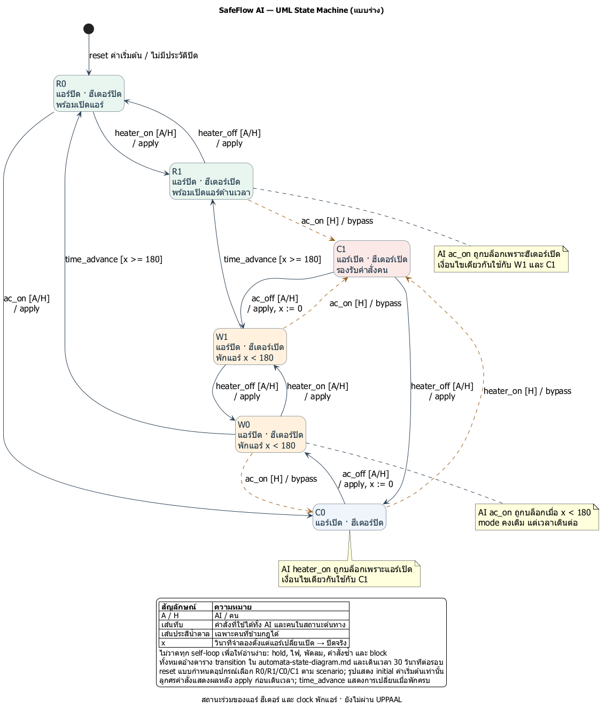
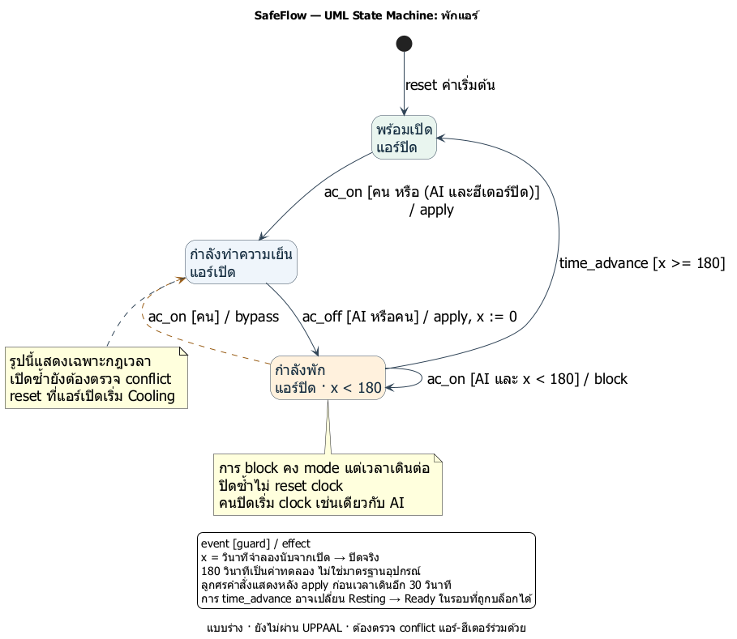
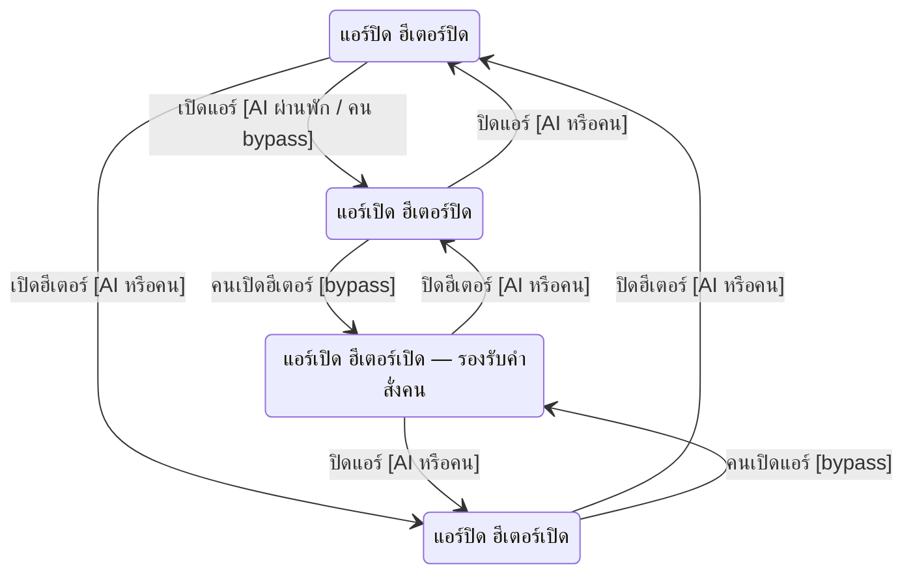
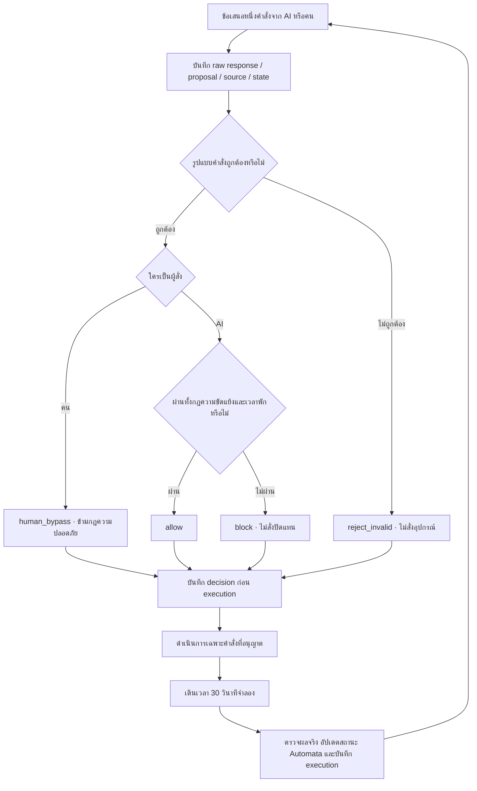

# SafeFlow — แบบร่างแผนภาพ Automata

บันทึกวันที่ 7 ตุลาคม 2569 เพื่อใช้ตรวจแบบออกแบบร่วมกันก่อนพัฒนาหรือทวนสอบต่อ

**สถานะ: แบบร่าง ยังไม่ผ่าน UPPAAL และยังไม่ใช่หลักฐานว่าโค้ดตรงกับแบบจำลองทุกกรณี**
รูปนี้เรียบเรียงจากกฎและต้นแบบปัจจุบัน ไม่ได้สร้างจาก trace เพื่อถือว่าพฤติกรรมอื่นเป็นไปไม่ได้

## 1. UML State Machine ของสถานะร่วม



[เปิดภาพ SVG ขยายได้](safeflow-states.svg) · [โค้ด PlantUML ที่แก้ไขได้](safeflow-states.puml)

จุดดำคือสถานะเริ่มต้น กล่องมุมมนคือสถานะ และลูกศรคือการเปลี่ยนสถานะ อ่านข้อความบนลูกศรเป็น `เหตุการณ์ [เงื่อนไข] / ผลที่เกิดขึ้น` โดย A คือ AI และ H คือคน เส้นประสีน้ำตาลแสดงการเปลี่ยนที่คนสั่งข้ามกฎได้ สภาพแวดล้อมจึงยังรองรับแอร์และฮีเตอร์เปิดพร้อมกัน แต่ AI ไม่ได้รับอนุญาตให้เปิดอุปกรณ์จนเกิดความขัดแย้ง

รูปนี้แสดงการเปลี่ยนหลัก ส่วนคำสั่งซ้ำ hold ไฟ พัดลม และการบล็อกที่ไม่เปลี่ยนอุปกรณ์ ดูตารางหัวข้อ 4 เวลาเดินต่อได้แม้คำสั่งถูกบล็อก

## 2. Automata เวลาพักแอร์

ใช้สามสถานะอ่านง่าย กฎความขัดแย้งในรูปถัดไปต้องตรวจร่วมด้วย ไม่ใช่ตรวจรูปนี้เพียงรูปเดียว



[เปิดภาพ SVG](ac-cooldown-state-machine.svg) · [โค้ด PlantUML](ac-cooldown.puml)

- `x` คือเวลาจำลองตั้งแต่แอร์เปลี่ยนจากเปิดเป็นปิดจริง ค่า 180 วินาทีเป็นค่าทดลอง
- การปิดซ้ำขณะแอร์ปิดไม่ reset clock การเปิดซ้ำขณะแอร์เปิดไม่เป็นการเริ่มใหม่ แต่ยังตรวจ conflict
- คำสั่งคนปิดแอร์เริ่ม clock เช่นเดียวกับ AI คนเปิดกลับระหว่างพักได้
- ขณะ Cooling ยังติดตามเวลาเดิมได้ แต่กฎพักใช้กับการเปลี่ยนจากปิดเป็นเปิดเท่านั้น
- ไม่ใส่ invariant `x <= 180` ใน Resting โดยไม่มี transition รองรับ เพราะเวลาใน Python อาจกระโดดข้ามขอบด้วยรอบละ 30 วินาที การจัดสถานะใช้ `x < 180` / `x >= 180`
- Reset เริ่มตามอุปกรณ์ที่กำหนดใน scenario แอร์ปิดเริ่ม Ready เพราะไม่มีประวัติการปิด แอร์เปิดเริ่ม Cooling ไม่ถือว่าทุก scenario เริ่ม Ready

## 3. Automata ความขัดแย้งแอร์–ฮีเตอร์

ทุกเส้นที่ระบุ AI ต้องผ่านกฎพักแอร์ด้วยเมื่อเป็นการเปิดแอร์จากปิด คำว่าเปิดหรือปิดบนเส้นหมายถึงคำสั่งที่ดำเนินการสำเร็จจริง



AI ขอเปิดฮีเตอร์ใน AC หรือ Both ถูกบล็อก AI ขอเปิดแอร์ใน Heat หรือ Both ถูกบล็อก ส่วน AI ปิดอุปกรณ์และ `hold` ยังทำได้ Both เป็นสถานะที่รองรับ ไม่ใช่สถานะให้หยุดเพียงเพราะคนสั่งขัดกฎ

## 4. สถานะร่วมที่ต้องใช้จริง

สองรูปด้านบนเป็นมุมมองที่แยกให้อ่านง่าย ตัวตรวจจริงต้องใช้ **ผลร่วมของสองกฎ** ไม่เลือกตรวจเพียงกฎเดียว

| รหัส | แอร์ | ฮีเตอร์ | สถานะพัก | AI เปิดแอร์ | AI เปิดฮีเตอร์ |
|---|---|---|---|---|---|
| R0 | ปิด | ปิด | พร้อม | อนุญาต → C0 | อนุญาต → R1 |
| R1 | ปิด | เปิด | พร้อม | บล็อก conflict | อนุญาต คง R1 |
| W0 | ปิด | ปิด | กำลังพัก | บล็อก cooldown | อนุญาต → W1 |
| W1 | ปิด | เปิด | กำลังพัก | บล็อก conflict และยังพัก | อนุญาต คง W1 |
| C0 | เปิด | ปิด | ไม่ใช้เป็น guard เปิดซ้ำ | อนุญาต คง C0 | บล็อก conflict |
| C1 | เปิด | เปิด | ไม่ใช้เป็น guard เปิดซ้ำ | บล็อก conflict | บล็อก conflict |

R0/R1/W0/W1/C0/C1 เป็นชื่อสำหรับอธิบายแบบร่าง ยังไม่ใช่ชื่อ location ในไฟล์ UPPAAL ปัจจุบัน ซึ่งแยก Proposer/Guard/Plant และใช้ตัวแปรอุปกรณ์

| เหตุการณ์ที่เหลือ | ผลต่อสถานะร่วม |
|---|---|
| ปิดแอร์จาก C0 / C1 | W0 / W1 และ reset x เป็น 0 |
| ปิดแอร์ซ้ำเมื่อปิดอยู่ | คงสถานะ ไม่ reset x |
| ปิดฮีเตอร์จาก R1 / W1 / C1 | R0 / W0 / C0 ตามลำดับ |
| ปิดฮีเตอร์ซ้ำเมื่อปิดอยู่ | คงสถานะ |
| คนเปิดแอร์จาก R0/W0 หรือ R1/W1 | C0 หรือ C1 ตามสถานะฮีเตอร์ |
| คนเปิดฮีเตอร์จาก R0/W0/C0 | R1/W1/C1 ตามลำดับ |
| เวลาพักครบขณะแอร์ปิด | W0 → R0 และ W1 → R1 |
| hold หรือเปลี่ยนไฟ/พัดลม | ไม่เปลี่ยนสถานะอุปกรณ์ที่ใช้สองกฎ แต่เวลาเดินต่อ |
| AI ถูกบล็อก หรือคำสั่งผิดรูปแบบ | ไม่เปลี่ยน mode แต่เวลาเดินต่อ จึงอาจ W → R |

กรณี W1 ขอเปิดแอร์ โค้ดปัจจุบันรายงาน conflict เป็นเหตุผลแรก แม้พักยังไม่ครบด้วย ต้องแยกระหว่างผลตัดสินกับรายการเงื่อนไขที่ละเมิด

## 5. ตัวอย่าง trace สำหรับอ่านรูป

สมมติเริ่มแอร์เปิด ฮีเตอร์ปิด ที่เวลา 0

| เวลาตรวจ | ผู้สั่งและข้อเสนอ | ผลตัดสิน | สถานะหลังดำเนินการและเดินเวลา |
|---|---|---|---|
| 0 | AI ปิดแอร์ | allow เริ่ม x = 0 | เวลา 30, W0, x = 30 |
| 30 | AI เปิดแอร์ | block เพราะ x = 30 | เวลา 60, W0, x = 60 |
| 60–150 | AI hold สี่รอบ | allow | เวลา 180, R0, x = 180 |
| 180 | AI เปิดแอร์ | allow | เวลา 210, C0 |
| 210 | คนเปิดฮีเตอร์ | human_bypass | เวลา 240, C1 |
| 240 | AI ขอเปิดแอร์ซ้ำ | block conflict | เวลา 270, C1 |
| 270 | AI ปิดฮีเตอร์ | allow | เวลา 300, C0 |

ตารางนี้เป็น **ตัวอย่างที่จัดเตรียมเพื่ออธิบาย** ไม่ใช่ผลที่อ้างว่าโมเดลเสนอเอง

## 6. การใช้แบบร่างนี้ต่อ

ตรวจให้ตรงกันสามชั้น: รูป/ตารางนี้ → แบบจำลอง UPPAAL → runtime Python โดยยังไม่ถือว่าชั้นใดรับรองอีกชั้นอัตโนมัติ

ข้อถามหลักสำหรับ verifier คือ AI ที่ได้รับอนุญาตไม่เปิดอุปกรณ์ขัดแย้งหรือเปิดแอร์ก่อนพักครบ คำสั่งบล็อกไม่เปลี่ยน mode และแบบจำลองไม่มี deadlock ไม่ใช้ข้อกำหนดว่าทั้งบ้านไม่มีวัน Both เพราะคนข้ามกฎได้

ไฟล์ประกอบ:
- [ภาพสถานะพักแอร์ SVG](ac-cooldown-state-machine.svg)
- [ข้อกำหนดและสถานะการทวนสอบ](../guides/automata.md)
- [ตัวตรวจต้นแบบ](../../src/safeflow/automata.py)
- [แบบจำลอง UPPAAL ฉบับร่าง](../../formal/smart-home.xml)

รอบนี้เก็บแบบร่างแผนภาพเท่านั้น ไม่แก้กฎ runtime ไม่แก้เค้าโครง และไม่อ้างผลพิสูจน์เพิ่ม


## สร้างภาพจากโค้ดอีกครั้ง

ภาพสร้างด้วย PlantUML 1.2026.8 เก็บต้นฉบับ `.puml` คู่กับ PNG และ SVG การแก้โค้ดแล้วสร้างภาพใหม่ไม่ใช่การทวนสอบ UPPAAL และไม่ได้เปลี่ยน runtime อัตโนมัติ

จากโฟลเดอร์ repository ใช้ Java และ PlantUML JAR ที่ติดตั้งในโฟลเดอร์ Seminar:

```powershell
java '-Djava.awt.headless=true' -jar '../../tools/plantuml/plantuml.jar' -charset UTF-8 -tsvg docs/design/safeflow-states.puml docs/design/ac-cooldown.puml
java '-Djava.awt.headless=true' -jar '../../tools/plantuml/plantuml.jar' -charset UTF-8 -tpng docs/design/safeflow-states.puml docs/design/ac-cooldown.puml
```

## ภาคผนวก: ตำแหน่งตัวกำกับในลูป (Flowchart)



ถ้า log ก่อน execution ล้มเหลว ห้ามดำเนินการและหยุด episode ถ้าสถานะที่สังเกตไม่ตรงกับที่ติดตาม หรือ environment ล้มเหลว ให้หยุดเช่นกัน ไม่ retry คำสั่งเอง

